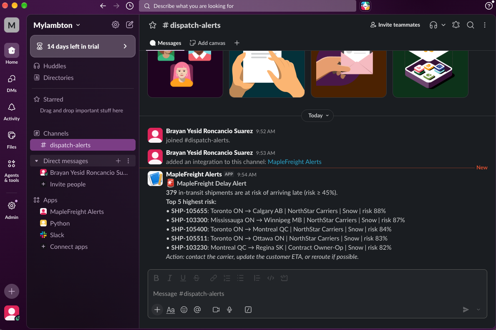

# MapleFreight Delivery Delay Prediction & Slack Alerts

**AML 3303 – Assessment 1** · Brayan Roncancio (c0966032) · Lambton College

## Problem

MapleFreight Logistics wants to know which shipments are going to arrive late **while they are still in transit**, so the dispatch team has time to do something about it (call the carrier, update the customer, reroute).

In this project I built a machine learning model that predicts if a shipment will be late (`delivered_late` = 1), and I connected it to Slack so the high-risk shipments are sent as an alert to the **#dispatch-alerts** channel.

## Dataset

- File: `data/maplefreight_delivery_delay_dataset.csv` (included in this repo)
- 6,035 rows and 23 columns (route, carrier, service level, weather, traffic, pickup delay, driver experience, etc.)
- Target: `delivered_late` → 79.4% on time / **20.6% late** (imbalanced)
- The data was "dirty" on purpose. Problems I found and fixed:
  - `service_level` had 6 spellings for 3 real values ("Standard" vs "standard") → standardized to lowercase
  - 32 exact duplicates + 2 duplicates hidden by the capitalization + 1 conflicting shipment ID → **6,000 rows** after cleaning
  - 40 weights recorded in grams instead of kg (up to 2,999,300 "kg") → divided by 1,000
  - Missing values in 4 columns (< 5% each) → filled inside the model pipeline
  - `actual_transit_hours` is only known **after** delivery, so I removed it to avoid **data leakage**

## How to run

1. Clone the repo and go into the folder:
   ```bash
   git clone https://github.com/brayanroncancio12/maplefreight-delay-prediction.git
   cd maplefreight-delay-prediction
   ```
2. Create an environment and install the libraries:
   ```bash
   conda create -n maplefreight python=3.11 -y
   conda activate maplefreight
   pip install -r requirements.txt
   ```
3. Set up Slack (only needed for the alert part):
   - Create an Incoming Webhook for the `#dispatch-alerts` channel (api.slack.com/apps → Incoming Webhooks)
   - Copy `.env.example` to `.env` and paste your webhook URL there:
     ```bash
     cp .env.example .env
     ```
   - `.env` is in `.gitignore`, so the webhook is never uploaded to GitHub.
4. Open `MapleFreight_Delivery_Delay_Prediction_c0966032.ipynb` and run all the cells from top to bottom.

## Key findings

- **Weather** is the biggest risk: Storm shipments are late 46.5% of the time and Snow 33.6%, vs 14.1% with Clear weather.
- **Carrier** matters a lot: Contract Owner-Op is late 36.0% of the time vs 12.8% for MapleFreight Fleet.
- Late shipments had **longer pickup delays** (median 28 min vs 16 min), **more traffic**, **longer routes** and **less experienced drivers**.
- Customer priority tier, fuel cost and weight have almost no effect on delays.

## Models and results (test set, 1,200 shipments)

| Model | Precision (late) | Recall (late) | F1 (late) | ROC-AUC |
|---|---|---|---|---|
| Baseline Logistic Regression | 0.715 | 0.356 | 0.476 | 0.820 |
| Logistic Regression (balanced) | 0.426 | 0.729 | 0.537 | 0.822 |
| **Random Forest (balanced)** | 0.498 | 0.603 | 0.546 | 0.811 |
| **Random Forest, threshold 0.45 (final)** | **0.467** | **0.717** | **0.565** | 0.811 |

- The baseline had 83.8% accuracy but only caught 36% of the late shipments, so accuracy is not a good metric here.
- I handled the imbalance with `class_weight="balanced"`, which gives the late shipments more weight during training.
- Most important features (permutation importance): `traffic_index`, `carrier`, `is_bad_weather` (a feature I created), `scheduled_transit_hours`, `num_stops` and `pickup_delay_minutes`.

## Chosen threshold: 0.45 (and why)

The model gives a probability of being late, and the threshold decides when we send an alert. I tested values from 0.20 to 0.70:

- With **0.30** the model catches 92% of late shipments, but it sends 752 alerts and only 30% are real. Dispatch would stop paying attention to them (alert fatigue).
- With **0.60** the alerts are more precise, but the model misses about 2 of every 3 late shipments.
- With **0.45** it catches **177 of 247 late shipments (71.7%)**, and about **1 in 2 alerts is a real delay**. It also has the best F1 (0.565).

I chose 0.45 because for dispatch, **missing a late shipment costs more than checking a false alarm**, but the number of alerts still has to be manageable. If the team has more people, the threshold could go down to 0.40 (79% recall).

## Slack alert

The notebook sends one message to `#dispatch-alerts` with the number of at-risk shipments and the top 5 highest-risk ones (ID, route, carrier, weather, risk %).



**Security:** the webhook URL works like a password, so it is stored only in `.env` (ignored by git). The notebook prints only `Webhook loaded: True`, and if the request fails, it prints only the error type, so the URL never appears in the output.

## Recommendations

1. Use the Slack alerts every day and prioritize the shipments with the highest risk.
2. Add extra buffer time and contact customers early when the forecast is Storm or Snow.
3. Review the Contract Owner-Op contracts, or move important shipments to the in-house fleet.
4. Improve pickup scheduling, because late pickups lead to late deliveries.
5. Fix data quality at the source: a dropdown for service level, always kg for weight, a timestamp for each record, and validated distances.
6. Check the precision/recall of the alerts every month and retrain the model with new data.

## AI usage

I used **Claude (Anthropic)** as a tutor during this assignment. It helped me with:
- Understanding concepts (data leakage, class imbalance, precision vs recall, thresholds, pipelines)
- Hints and example code for the cleaning, EDA, models and the Slack integration, which I ran and checked in my notebook
- Writing and correcting the English of my findings and this README

I also used the **VS Code autocomplete** while writing code.

**Cases where the AI was wrong:**
1. **Claude said the dataset had 7 text columns**, but when I ran `df.dtypes.value_counts()` the output showed **8** (`str 8`). I checked the real output and corrected it. Lesson: always verify what the AI says with the actual data.
2. **VS Code autocomplete added `from matplotlib.pylab import normal`** at the top of a cell when I was typing a variable called `normal_weights`. The import was not needed and could confuse readers, so I removed it. Lesson: read every line that gets added automatically.

## Repository structure

```
├── MapleFreight_Delivery_Delay_Prediction_c0966032.ipynb   # main notebook
├── data/maplefreight_delivery_delay_dataset.csv             # dataset
├── screenshots/slack_alert.png                              # Slack alert proof
├── requirements.txt
├── .env.example                                             # template (fake URL)
├── .gitignore                                               # includes .env
└── README.md
```
